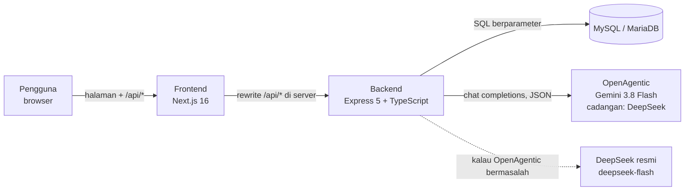
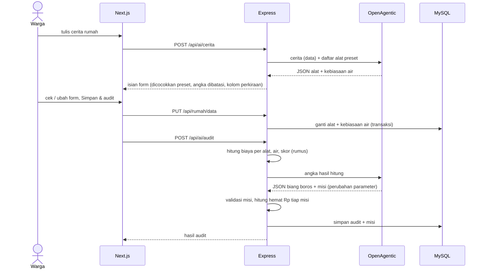
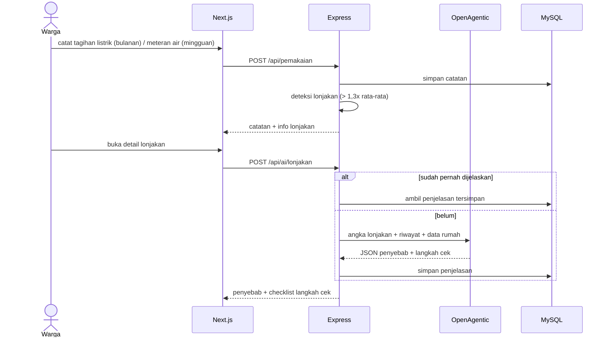

# Arsitektur

Bab laporan: 5.3 (non-fungsional), 5.4 (rancangan sistem).
Update kalau: alur antar frontend, backend, DB, atau AI berubah.

## Gambaran sistem

- Browser hanya bicara ke Next (satu origin). Next meneruskan `/api/*` ke Express di sisi server, jadi tidak ada CORS dan cookie sesi tetap same-origin.
- Express satu-satunya yang memegang kredensial DB dan API key AI. Frontend tidak pernah memanggil AI langsung.
- Semua angka (kWh, m³, Rupiah, skor, lonjakan, hemat misi) dihitung backend (`api/src/hitung.ts`, `api/src/lib/pemakaian.ts`). AI hanya menafsirkan dan merekomendasikan.

## Alur utama: cerita -> data -> audit -> rencana

## Alur pantau: catat -> lonjakan -> penjelasan

## Struktur kode
| Folder | Isi |
|---|---|
| `web/src/app/` | Halaman Next (App Router), `/design` contekan komponen |
| `web/src/components/` | Komponen shadcn (`ui/`) + komponen app (`IconTile`) |
| `web/src/lib/` | `api.ts` (fetch ke `/api`), `format.ts` (Rupiah, angka) |
| `api/src/routes/` | Endpoint per fitur: auth, rumah, pemakaian, lonjakan, beranda, ai, audit, misi |
| `api/src/ai/` | Client AI, prompt, saringan keamanan teks AI |
| `api/src/hitung.ts` | Rumus biaya, skor, hemat misi |
| `api/src/lib/` | Auth (JWT cookie), format error, seri pemakaian & lonjakan, bentuk respons audit |
| `api/db/migrations/` | Skema DB (SQL) |
| `api/src/seed.ts` | Alat preset + akun demo |

## Kebutuhan non-fungsional (Bab 5.3)
| Aspek | Target | Cara memenuhi |
|---|---|---|
| Keamanan | Data rumah hanya bisa dilihat pemiliknya; key AI tidak bocor | Login cookie httpOnly, cek kepemilikan di setiap query, key hanya di env server, rate limit, validasi input & output AI (`docs/SECURITY.md`) |
| Kemudahan pakai | Bisa dipakai orang tua tanpa paham watt/kWh | Input cerita bahasa sehari-hari, hasil dalam Rupiah, huruf ≥16px, tombol ≥44px, satu aksi utama per halaman |
| Keandalan AI | Halaman tidak rusak walau AI gagal/lambat | Timeout 45 dtk, 1x ulang, validasi skema, pesan error ramah + tombol coba lagi, form manual tetap bisa dipakai |
| Konsistensi angka | Input sama, hasil sama | Semua angka dari rumus backend, bukan dari AI |
| Performa | Halaman non-AI cepat; AI dengan indikator | Endpoint non-AI < 1 dtk; cerita ±5-10 dtk, audit ±20-30 dtk dengan loading; penjelasan lonjakan di-cache |
| Portabilitas | Jalan lokal tanpa deploy (Guide Book I.2.a) | `npm run dev` + MySQL/MariaDB (XAMPP); deploy VPS hanya untuk QA tim |
