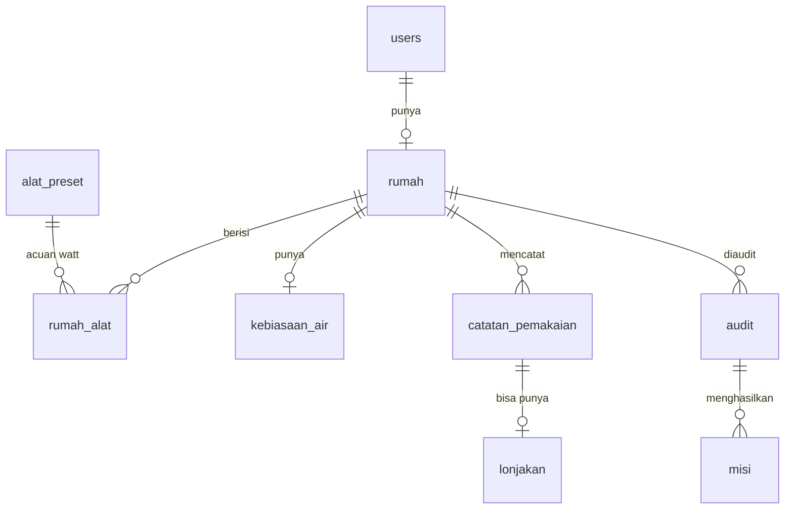

# Database

Bab laporan: 5.5.
Update kalau: tabel, kolom, atau relasi berubah (tiap bikin/ubah migration).

MySQL (lokal boleh MariaDB/XAMPP, VPS MariaDB 10.11). `utf8mb4`. Kolom JSON pakai tipe `JSON` (di MariaDB jadi LONGTEXT + cek valid, aman).

## ERD

## Tabel
### users
| Kolom | Tipe | Keterangan |
|---|---|---|
| id | INT PK AI | |
| nama | VARCHAR(100) | |
| email | VARCHAR(191) UNIQUE | lowercase |
| password_hash | VARCHAR(255) | bcrypt |
| created_at | DATETIME | |

### rumah (1 per user)
| Kolom | Tipe | Keterangan |
|---|---|---|
| id | INT PK AI | |
| user_id | INT UNIQUE FK users | |
| penghuni | TINYINT | 1-20 |
| daya_va | INT | 450/900/1300/2200/... |
| jenis_listrik | ENUM('token','pascabayar') | |
| tarif_listrik | DECIMAL(10,2) | Rp/kWh dari tagihan user |
| tarif_air | DECIMAL(10,2) NULL | Rp/m³, NULL = tanpa PDAM |
| updated_at | DATETIME | |

### alat_preset (seeder)
| Kolom | Tipe | Keterangan |
|---|---|---|
| id | INT PK AI | |
| nama | VARCHAR(60) | |
| watt | INT | perkiraan umum, bisa diubah per rumah |
| jam_wajar | DECIMAL(4,1) | batas jam/hari dianggap wajar, dipakai rumus skor |
| kategori | VARCHAR(30) | pendingin, dapur, hiburan, air, ... |

### rumah_alat
| Kolom | Tipe | Keterangan |
|---|---|---|
| id | INT PK AI | |
| rumah_id | INT FK rumah | |
| preset_id | INT NULL FK alat_preset | NULL = Alat lain |
| nama | VARCHAR(60) | |
| jumlah | TINYINT | 1-50 |
| jam_per_hari | DECIMAL(4,1) | 0-24 |
| hari_per_minggu | TINYINT | 1-7 |
| watt | INT | 1-5000 |
| dari_ai | BOOLEAN | buat tanda "perkiraan AI" |

### kebiasaan_air (1 per rumah)
| Kolom | Tipe |
|---|---|
| rumah_id | INT PK FK rumah |
| mandi_per_hari | TINYINT |
| cara_mandi | ENUM('gayung','shower') |
| cuci_baju_per_minggu | TINYINT |
| cuci_pakai_mesin | BOOLEAN |
| siram_tanaman_per_minggu | TINYINT |
| cuci_kendaraan_per_minggu | TINYINT |

### catatan_pemakaian (listrik & air satu tabel)
| Kolom | Tipe | Keterangan |
|---|---|---|
| id | INT PK AI | |
| rumah_id | INT FK rumah | |
| jenis | ENUM('listrik','air') | |
| tanggal | DATE | listrik: tanggal 1 bulan itu; air: tanggal baca meteran |
| nilai | DECIMAL(12,2) | listrik: Rp tagihan/token; air: angka meteran m³ |
| created_at | DATETIME | |
UNIQUE (rumah_id, jenis, tanggal).

### lonjakan
| Kolom | Tipe | Keterangan |
|---|---|---|
| catatan_id | INT PK FK catatan_pemakaian | |
| rasio | DECIMAL(8,2) | Dilebarkan dari (4,2) di migrasi 002: rasio ≥ 100× (salah ketik tagihan) dulu gagal disimpan |
| ai_json | JSON | penyebab + langkah + kapan panggil tukang (cache, AI cukup sekali) |
| langkah_selesai | JSON | array bool per langkah |
| created_at | DATETIME | |

### audit
| Kolom | Tipe | Keterangan |
|---|---|---|
| id | INT PK AI | |
| rumah_id | INT FK rumah | |
| skor | TINYINT | rumus backend |
| kwh_bulan, rp_listrik, m3_bulan, rp_air | DECIMAL / INT | |
| rincian_json | JSON | rincian per alat & kegiatan air (hasil hitung) |
| ai_json | JSON | biang_boros + ringkasan |
| created_at | DATETIME | |

### misi
| Kolom | Tipe | Keterangan |
|---|---|---|
| id | INT PK AI | |
| audit_id | INT FK audit | audit baru -> misi lama dihapus |
| rumah_id | INT FK rumah | |
| urutan | TINYINT | dari hemat_rp terbesar |
| judul, deskripsi | VARCHAR(120), VARCHAR(300) | dari AI |
| target_tipe | ENUM('alat','air') | |
| target_ref | VARCHAR(40) | alat: `<rumah_alat.id>:<field>` (mis. `12:jam_per_hari`); air: nama field kebiasaan_air |
| nilai_lama, nilai_baru | DECIMAL(6,1) | mis. jam 8 -> 6 |
| hemat_rp | INT | hitung backend |
| selesai | BOOLEAN | |
| selesai_at | DATETIME NULL | |
