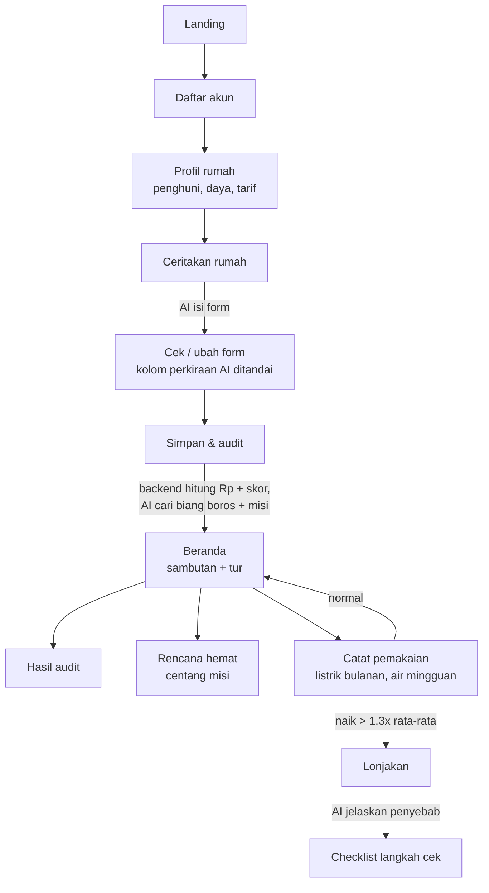

# Antarmuka

Bab laporan: 5.6 (rancangan), 7 (screenshot).
Update kalau: halaman ditambah / diubah. Screenshot simpan di `screenshots/NN-nama-halaman.png`.

Screenshot (7 Nov, 1440×900, data lokal akun demo + akun Budi): `docs/screenshots/` (00 landing … 09 beranda HP, 08b riwayat lonjakan).
Diagram PNG untuk laporan & folder Dokumentasi: `docs/diagram/` (arsitektur, alur pengguna, alur cerita-audit, alur pantau-lonjakan, ERD), dirender dari blok mermaid di ARCHITECTURE.md, UI.md (§ Alur), DATABASE.md.

Mockup alur (bukan desain final): buka `docs/mockup.html` di browser. Sumber konsep: Konsep Final HematRumah (7 Nov 2026).

## Prinsip
- Pengguna utama orang tua: huruf badan >= 16px, tombol tinggi >= 44px, satu tujuan per layar, bahasa sehari-hari, angka dalam Rupiah.
- **Website**, desktop dulu (demo di laptop), tetap responsif: di bawah ±900px kolom bertumpuk jadi satu.
- Setiap panggilan AI: loading ("AI sedang ..."), error + tombol coba lagi, empty state.
- Semua angka (kWh, m³, Rp, skor, rasio lonjakan, hemat per misi) dari backend. Frontend cuma menampilkan + menjumlah misi yang dicentang.
- Panggil API relatif `/api/...`.
- Warna punya arti: biru tinta `#1f3354` = brand/tombol, kuning `#e3a008` = listrik, biru `#2478b5` = air, oranye bata `#c2410c` = peringatan, krem `#faf8f4` = latar. Bukan hijau.
- Kartu tanpa garis warna di sisi kiri; pakai ikon alat dalam kotak lembut.
- **Status implementasi (Andre)**: semua halaman `docs/UI.md` sudah ada di `web/src/app/` dan tersambung ke backend hosting (`API_URL=https://iscomfest-be.jstnlt.id`). Tidak ada data contoh/dummy di kode. Kolom perkiraan AI = garis putus-putus.

## Design system di kode (`web/`)
- Contekan hidup: jalankan web, buka **http://localhost:3000/design** (warna, tombol, ikon, dialog, checkbox misi, 2 grafik).
- **Logo**: `web/src/components/logo.tsx` → `<IkonHematRumah varian="gelap|terang" />` (ikon saja) dan `<MerekHematRumah varian ukuran />` (ikon + tulisan). `terang` untuk latar gelap (sidebar, navbar landing, panel masuk), `gelap` untuk latar putih. Jangan pakai ikon lain untuk merek. File asli desainer: `web/public/brand/` (SVG, PNG 512, logo tanpa tagline); favicon di `web/src/app/favicon.ico` + `icon.png` + `apple-icon.png`.
- File bersama yang wajib dipakai ulang (jangan bikin versi baru):
  - `web/src/components/app-shell.tsx` → `AppShell` (dashboard: sidebar gelap kiri, isi di lembar #f4f6fa membulat, di HP bar atas + tab bawah, footer nomor versi), `PageHead` (judul + aksi + tombol kembali pil), `Logo`, `useSession` (panggil dari komponen DI DALAM `AppShell`)
  - `web/src/components/states.tsx` → `AiLoading` ("AI sedang menganalisis..."), `Loading` = skeleton sesuai bentuk halaman (`bentuk="dasbor|laporan|daftar|form"`), `Loading`, `ErrorState` (+ tombol coba lagi), `EmptyState`
  - `web/src/components/icon-tile.tsx` → `IconTile`
- `web/src/components/ilustrasi.tsx` → set ilustrasi datar (palet sama, kanvas 320x220): `IlustrasiRumahTenang`, `IlustrasiPeriksa`, `IlustrasiCelengan`, `IlustrasiCatat`, `IlustrasiColokan`, `IlustrasiBeres`, `IlustrasiSambutan`, `IlustrasiPutus`, `IlustrasiKalender`, `IlustrasiAnalisis` (beranimasi). Dipakai di empty state (`EmptyState ilustrasi={...}`), 404, sambutan profil, langkah cek selesai. Jangan dipakai di kartu yang sudah berisi data.
- Checklist selesai semua (langkah cek lonjakan, misi rencana) = konfeti `rayakan()` (`web/src/lib/rayakan.ts`, hanya dari centang terakhir, bukan saat halaman dibuka) + kartu selesai dengan `IlustrasiBeres`.
- Proses AI yang ditekan pengguna (proses cerita, simpan & audit) = modal `ProsesAi` (`states.tsx`), tidak bisa ditutup sampai selesai. Kalau gagal, modal yang sama berganti ke tampilan gagal (prop `gagal`): ilustrasi per jenis error (JARINGAN = Putus, BATAS_AI = Kalender, lainnya = Periksa), alasan dari server, Coba lagi + jalan keluar ("Atur data dulu" / "Isi form manual"). Isian ditolak server tetap ditandai di form. AI yang jalan otomatis saat halaman dibuka (detail lonjakan) = `AiLoading` inline dengan ilustrasi.
  - `web/src/components/alat-icon.tsx` → `ikonAlat(nama)` + `toneAlat(nama)`, ikon sama untuk alat yang sama di semua halaman
  - `web/src/lib/api.ts` (`api`, `ApiError`), `web/src/lib/use-api.ts` (`useApi`, `pesanError`), `web/src/lib/format.ts`, `web/src/lib/types.ts` (tipe kontrak API)
  - `web/src/components/catat-dialog.tsx`, `web/src/components/rumah/alat-editor.tsx`, `web/src/components/rumah/profil-form.tsx` (form profil, dipakai di /profil dan modal Ubah profil)
- Nomor commit di footer: `NEXT_PUBLIC_COMMIT`, diisi `git rev-parse --short HEAD` saat build (`next.config.ts`), fallback `dev`.
- Warna = token shadcn di `web/src/app/globals.css` + class semantik: `bg-listrik`, `bg-listrik-soft`, `text-listrik-foreground`, `bg-air`, `bg-air-soft`, `text-air`, `bg-warn`, `bg-warn-soft`, `text-warn`, `bg-primary-soft`. Grafik: `var(--chart-1)` listrik, `--chart-2` air, `--chart-3` peringatan, `--chart-5` batang "sebelum".
- **Full shadcn** (style base-nova, Base UI): modal = `Dialog`, tab = `Tabs`, toast = `toast()` dari sonner (Toaster sudah di layout), dll. Jangan bikin komponen UI sendiri kalau shadcn punya. Trigger pakai prop `render`, bukan `asChild`: `<DialogTrigger render={<Button variant="outline" />}>Buka</DialogTrigger>`.
- Ukuran sudah dibesarkan untuk orang tua: Button default 44px (lg 48px), Input/Select 44px, teks 16px. Tidak perlu class tambahan.
- Ikon dalam kotak: `<IconTile icon={Zap} tone="listrik|air|warn|primary" size="sm|md|lg" />` (`web/src/components/icon-tile.tsx`).
- Format angka: `rupiah(520500)` -> Rp520.500, `rupiahRingkas(108400)` -> Rp108rb, `angka(6.2)` -> 6,2, `tanggal(iso)` (`web/src/lib/format.ts`).
- Panggil API: `api<T>("/rumah")`, `api("/pemakaian", { method: "POST", json: {...} })`; error = `ApiError` dengan `kode`, `pesan` siap tampil (`web/src/lib/api.ts`).
- Font Plus Jakarta Sans sudah di `layout.tsx`.
- Footer menampilkan versi: `versi <commit> · build <waktu WIB>`. Di VPS (Docker tanpa .git) hanya waktu build. Buat QA: cocokkan waktu build dengan pesan "DEPLOY" di grup.

## Library
| Kebutuhan | Pakai | Pasang |
|---|---|---|
| Komponen | shadcn/ui: button, card, input, label, tabs, dialog, table, checkbox, badge, select, sonner | `cd web && npx shadcn@latest add button card input label tabs dialog table checkbox badge select sonner` |
| Ikon | lucide-react (ikut shadcn) | - |
| Grafik | shadcn Chart (Recharts) | `cd web && npx shadcn@latest add chart` |
| Font | Plus Jakarta Sans via `next/font/google` | - |

Grafik: Beranda listrik per bulan = `BarChart` kuning · Beranda air per minggu = `LineChart` biru + `ReferenceLine` (rata-rata) + `ReferenceDot` (lonjakan) · Audit skor = `RadialBarChart` atau SVG · Biaya per alat = div + Tailwind · Rencana sebelum/sesudah = `BarChart` + `ReferenceLine`.

## Halaman
| No | Halaman | Route | Isi utama | Dipakai oleh |
|---|---|---|---|---|
| 00 | Landing | `/` | Hero "Coba ceritain rumahmu" dengan animasi cerita -> kabel -> biaya per alat, cara kerja, lonjakan air, contoh hasil (data demo Ibu Sri), keamanan, FAQ, CTA. Palet putih + biru tua, latar gelap bergaris kabel. Kode: `web/src/app/page.tsx` + `web/src/components/landing/` | Pengunjung, juri |
| 01 | Masuk / Daftar | `/masuk`, `/daftar` | Email + kata sandi. Layar lebar: panel gelap kiri (tagline + 3 contoh hasil demo bergantian), form di kanan | Semua |
| 02 | Profil Rumah | `/profil` | Penghuni, daya VA, jenis listrik (token / tagihan), tarif listrik Rp/kWh, tarif air Rp/m³ | Pertama kali, edit dari tab Rumah |
| 03 | Data Rumah | `/rumah?tab=cerita` / `/rumah?tab=form` | Tab Ceritakan (teks bebas -> AI isi form) dan tab Isi Form (alat: jumlah, jam/hari, hari/minggu, watt; kebiasaan air). Tombol Simpan & Audit hanya di tab Form | Pertama kali, edit kapan saja |
| 04 | Hasil Audit | `/audit` | Skor 0-100, total listrik & air per bulan, ranking biaya per alat, 3 biang boros (AI) | Setelah simpan |
| 05 | Rencana Hemat | `/rencana` | Misi + hemat Rp/bulan, centang, total hemat, grafik sebelum vs sesudah | Rutin |
| 06 | Beranda | `/beranda` | Banner lonjakan, skor, target hemat, grafik listrik per bulan & air per minggu, tombol Catat. Bacaan air pertama = penjelasan titik awal, 2 bacaan = hitungan pemakaian pertama (bukan grafik 1 titik). "Perlu dicek" menampilkan kesiapan cek lonjakan (listrik 3 bulan, air 4 bacaan). Tombol "Lihat & ubah catatan" -> modal Riwayat catatan (`components/riwayat-catatan.tsx`): ubah angka (periode terkunci) / hapus dengan konfirmasi di baris | Halaman utama setelah setup |
| 07 | Catat pemakaian | dialog di Beranda | Tab Listrik (bulan + Rp tagihan / total token) dan tab Air (tanggal + angka meteran m³). Tab awal ikut tab grafik. Validasi per isian (`skemaCatatListrik/Air` di `lib/validasi.ts`), Rupiah ditulis ulang di bawah isian, meteran dicek terhadap catatan sebelum & sesudah tanggalnya. Mode ubah dari Riwayat catatan | Rutin |
| 08a | Lonjakan | `/lonjakan` | Lonjakan yang sedang terjadi (minggu ini vs biasanya, Rp terbuang) + riwayat lonjakan + penjelasan kapan disebut lonjakan | Saat ada lonjakan |
| 08 | Detail lonjakan | `/lonjakan/[id]` | Angka minggu ini vs biasanya, kemungkinan penyebab (AI), checklist langkah cek | Saat ada lonjakan |

Onboarding 2 langkah, menu terkunci sampai selesai: (1) /profil, (2) /rumah mode awal (tab Ceritakan + stepper + tur sorot "cerita" dan "form"). Simpan & audit pertama -> /beranda?selamat=1 (modal sambutan + tur Beranda). Tur pakai driver.js (`components/tur.tsx`, sekali per akun di browser, "Ulangi tur" di menu akun -> /beranda?tur=1). Audit/Rencana kosong memakai `KosongAwal`. Menu sidebar (setelah login): Beranda · Lonjakan · Data Rumah · Hasil Audit · Rencana Hemat. Profil rumah diubah lewat modal di Data Rumah (/profil untuk pengisian pertama). Tombol "Catat pemakaian" di Beranda. Semua modal memakai gaya `components/ui/dialog.tsx` (sudut 28px, judul biru tinta, tombol pil, Batal = outline).

## Alur

Pertama kali: Daftar -> Profil Rumah -> Data Rumah (Ceritakan -> AI isi form -> cek/ubah) -> Simpan & Audit -> Hasil Audit -> Rencana Hemat -> Beranda.
Rutin: Beranda -> Catat (listrik per bulan, air per minggu) -> kalau lonjakan: banner -> Detail lonjakan -> centang langkah cek. Misi dicentang di Rencana.

## Aturan Data Rumah (dari Konsep Final)
- Form = satu-satunya sumber data. Cerita cuma jalan pintas mengisi form, tidak disimpan.
- Kolom yang diisi AI diberi tanda "perkiraan AI".
- Form sudah terisi lalu bercerita lagi -> modal `GabungCerita` (`components/rumah/gabung-cerita.tsx`): isi form nanti tampil seperti diff (+ baru hijau, ± berubah, − dihapus merah) mengikuti pilihan Gabungkan / Ganti semua. Alat sama digabung.
- Alat di luar daftar -> "Alat lain", watt diisi pengguna.
- AI gagal / lambat -> pesan ramah + coba lagi; form manual tetap bisa dipakai.

## Endpoint yang dipanggil (draf, detail di kontrak endpoint)
- AI: `POST /api/ai/cerita` (tidak menyimpan), `POST /api/ai/audit`, `POST /api/ai/lonjakan`
- Lain: auth, profil rumah, `PUT /api/rumah/data` (alat + kebiasaan air), catatan pemakaian, misi (centang)
